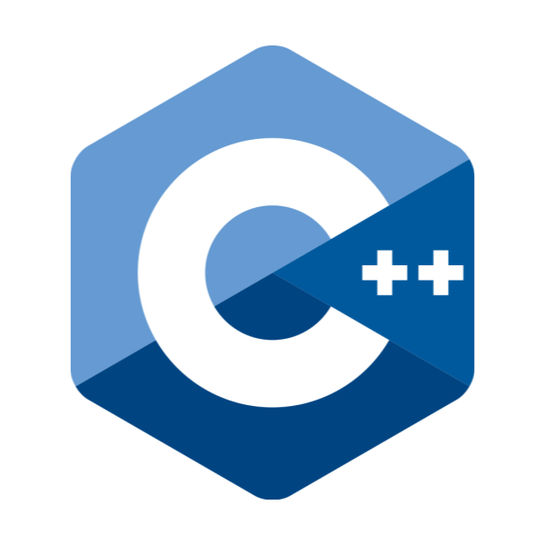
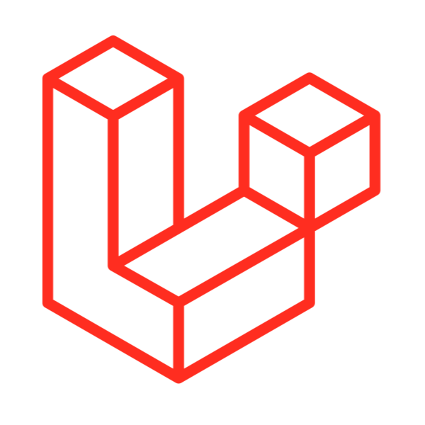

# Welcome the My Profile!
## Languages
<div display="flex">
  
  
  
  
  
  
  
  
  
  
</div>

## Frameworks
<div display="flex">
  
  
  
  
  
  
  
  
  
  
  
</div>
<br>

## My Links:
[](https://wraith.com.tr)
[](https://discord.com/users/523113284853825546)
[](https://open.spotify.com/user/31y5r7w2jlpzlitzde5ahyc7spgi)


<!--START_SECTION:waka-->

```rust
From: 06 June 2024 - To: 09 November 2026

Total Time: 2,486 hrs 54 mins

TypeScript                         1,484 hrs 3 mins      >>>>>>>>>>>>>>>----------   58.76 %
Svelte                             282 hrs 16 mins       >>>----------------------   11.18 %
Markdown                           224 hrs 22 mins       >>-----------------------   08.88 %
JSON                               93 hrs 4 mins         >------------------------   03.69 %
Rust                               81 hrs 5 mins         >------------------------   03.21 %
Python                             44 hrs 34 mins        -------------------------   01.76 %
Other                              38 hrs 35 mins        -------------------------   01.53 %
JavaScript                         32 hrs 58 mins        -------------------------   01.31 %
CSS                                24 hrs 34 mins        -------------------------   00.97 %
YAML                               17 hrs 2 mins         -------------------------   00.67 %
```

<!--END_SECTION:waka-->
