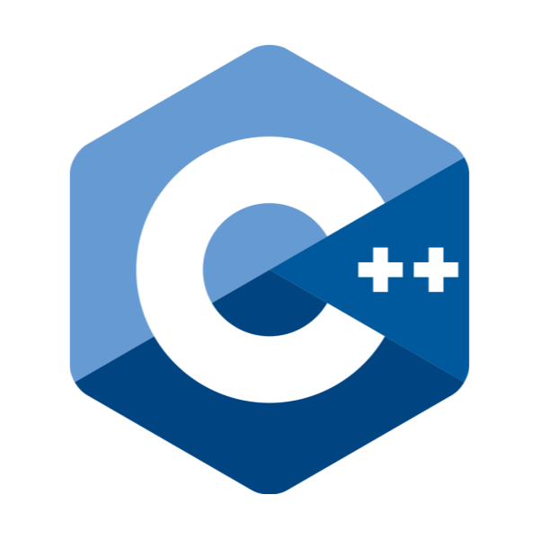
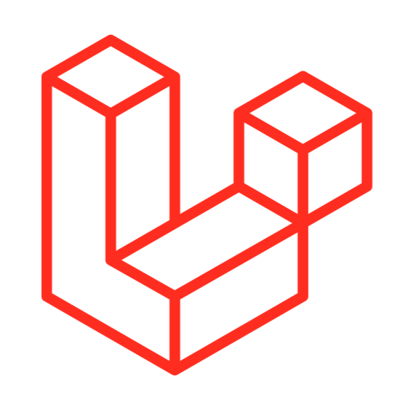

# Welcome the My Profile!
## Languages
<div display="flex">
  
  
  
  
  
  
  
  
  
  
</div>

## Frameworks
<div display="flex">
  
  
  
  
  
  
  
  
  
  
  
</div>
<br>

## My Links:
[](https://wraith.com.tr)
[](https://discord.com/users/523113284853825546)
[](https://open.spotify.com/user/31y5r7w2jlpzlitzde5ahyc7spgi)


<!--START_SECTION:waka-->

```rust
From: 06 June 2024 - To: 23 November 2026

Total Time: 2,553 hrs 28 mins

TypeScript                         1,498 hrs 38 mins     >>>>>>>>>>>>>>-----------   57.78 %
Svelte                             284 hrs 58 mins       >>>----------------------   10.99 %
Markdown                           251 hrs 19 mins       >>-----------------------   09.69 %
JSON                               94 hrs 59 mins        >------------------------   03.66 %
Rust                               94 hrs 45 mins        >------------------------   03.65 %
Python                             46 hrs 16 mins        -------------------------   01.78 %
Other                              40 hrs 16 mins        -------------------------   01.55 %
JavaScript                         33 hrs 54 mins        -------------------------   01.31 %
CSS                                24 hrs 35 mins        -------------------------   00.95 %
YAML                               18 hrs 1 min          -------------------------   00.69 %
```

<!--END_SECTION:waka-->
